<p align="center">
  
</p>

O Nethergate é uma aplicação desktop para criar e gerir servidores Minecraft Java a partir de um computador pessoal. Este reúne a instalação, a consola, os jogadores, os mods e os backups numa única interface.

Os mundos ficam sob o controlo do utilizador. Sem a necessidade de criar qualquer tipo de conta; serviços externos, como túneis e armazenamento cloud, são opcionais.

## O que é possivel fazer

- Criar servidores Paper e Fabric, preparar o Java, gerir e acompanhar o arranque pela consola dos servidores.
- Gerir jogadores e whitelist, alterar opções de jogo e definir a memória de cada servidor.
- Procurar mods e plugins no Modrinth, resolver dependências e importar JARs locais.
- Escolher entre acesso no computador, na rede local ou pela internet. Inclui diagnóstico, DuckDNS, playit e encaminhamento de portas por UPnP ou NAT-PMP.
- Criar backups manuais ou agendados, escolher uma pasta externa e recuperar restauros interrompidos através de um fluxo guiado.
- Guardar cópias em S3 compatível, Google Drive ou Dropbox, com compressão, deduplicação e retoma por blocos.
- Exportar e importar servidores e preparar uma cópia para uma versão superior do Minecraft, preservando o original.
- Manter os servidores ativos em segundo plano com um consumo reduzido.
- Gerir servidores privados podendo personalizar toda a experiência através de uma interface familiar e fácil de navegar.

## Estado do projeto

A versão atual é a prévia **0.2.0**, com o desktop orientado para Windows x64. O núcleo e a CLI também têm verificações em Linux, mas as integrações de sistema e a proteção de credenciais ainda dependem do Windows.

O instalador ainda não está assinado e não existem atualizações automáticas.

A ligação pela internet depende da rede e dos serviços escolhidos. Um nome DuckDNS acompanha o IP público, mas não contorna CGNAT nem abre portas. Os backups automáticos locais aguardam que o servidor pare; não desligam uma sessão de jogo. A migração de mundos não suporta downgrade.

## Instalar no Windows

O Nethergate é distribuído através de um instalador `.exe` para Windows x64. Quando a versão estiver publicada, o instalador estará disponível na secção **Releases** deste repositório.

1. Transferir o ficheiro `Nethergate_0.2.0_x64-setup.exe` da versão pretendida.
2. Executa o instalador e seguir os passos apresentados.
3. Iniciar o Nethergate

O instalador prepara o WebView2 se estiver em falta, e a aplicação pode preparar o Java necessário aos servidores. Estes downloads precisam de ligação à internet.

Esta prévia ainda não tem assinatura de editor, pelo que o Windows pode apresentar um aviso de aplicação desconhecida. As atualizações são instaladas manualmente através de uma nova versão do instalador.

## Executar em desenvolvimento

Node.js 22, Rust estável e dos pré-requisitos do Tauri para Windows: ferramentas de compilação C++ do Visual Studio e WebView2.

```sh
npm ci
npm run desktop
```

O Java é preparado pela aplicação quando necessário. O download e a execução do servidor Minecraft exigem a aceitação da respetiva EULA. Os pedidos ao PaperMC também precisam de um contacto válido no perfil.

Para gerar o instalador Windows:

```sh
npm run package:windows
```

O resultado fica em `src-tauri/target/release/bundle/nsis/`. O instalador desta prévia não tem assinatura de editor.

O núcleo também pode ser usado pela linha de comandos:

```sh
cargo run --locked -- --help
```

## Dados e privacidade

Na instalação Windows, a biblioteca fica por defeito em `%LOCALAPPDATA%/NetherGateData`. Este nome interno é mantido por compatibilidade. Também podes escolher uma biblioteca existente. O launcher `Abrir Nethergate.cmd` usa a pasta do projeto e requer uma compilação desktop prévia.

Mundos, backups, runtimes e credenciais locais ficam fora do controlo de versões. As credenciais guardadas usam a proteção da conta Windows. A aplicação só deve ser usada no próprio computador: a API local não foi concebida como painel administrativo público.

Os fornecedores externos têm as suas próprias contas e condições. A interface identifica os pedidos de autorização necessários para publicar DNS, testar ligações ou ligar armazenamento cloud. Consulta a [configuração cloud](docs/cloud.md) para ligar um destino de backups.

## Estrutura e verificações

`src/` contém o núcleo Rust e a CLI; `src-tauri/` integra a janela desktop; `ui/` contém os componentes React e o tema. `scripts/` reúne os auxiliares de sistema e ferramentas de desenvolvimento, e `tests/` contém os testes de integração e interface.

```sh
cargo fmt --check
cargo clippy --locked --all-targets -- -D warnings
cargo test --locked
npm run build
```

As instruções para preparar o ambiente e executar os testes de interface e desktop estão no [guia de desenvolvimento](docs/development.md).

## Licença e recursos

O código do Nethergate é distribuído sob **GPL-3.0-only**. O código pode ser usado, estudado, modificado e redistribuido consoante os termos da [licença](LICENSE).

Fontes, texturas, imagens e dependências mantêm as suas próprias licenças. A origem e as pendências dos recursos gráficos estão descritas em [recursos de terceiros](THIRD_PARTY_NOTICES.md).

O Nethergate é um projeto independente, sem afiliação à Mojang ou à Microsoft. Minecraft é uma marca dos respetivos titulares.
